# On Fire 🔥

**25 years of NASA fire detections, one consistent burning-activity calendar.**

NASA Space Apps Challenge 2026 · Challenge: **Harmonization of MODIS and VIIRS Hot Spots** ·
Team **On Fire** · NASA Space Apps Cairo 2026

| | |
|---|---|
| ▶️ **Demo video (29 s)** | https://www.youtube.com/watch?v=iv5ABSGmRbU |
| 💻 **Run it** | Windows: install Node.js + Python, download this repository, double-click **`setup.bat`** ([details](#run-it)) |
| 📦 **Data download** | [Release `data-v1`](https://github.com/Abdelrahman-ahmed-cs/on-fire/releases/tag/data-v1) (fetched by `setup.bat` automatically) |

[](https://www.youtube.com/watch?v=iv5ABSGmRbU)

---

## Team

| # | Member |
|---|---|
| 1 | Abdelrahman Ahmed Abdelhamied |
| 2 | Ahmed Mohamed Saad |
| 3 | Ahmed Mahmoud Ragab |
| 4 | Asser Ayman Elsamad |
| 5 | Ahmed Atef El Wakil |
| 6 | Abdelrahman Mohamed Abu Zahra |

---

## The problem

Satellites have watched fires for more than 20 years, but the record comes from two sensors that
count fire very differently. NASA's **MODIS** sensors (Terra and Aqua, since 2000) see the Earth in
1 km pixels. The newer **VIIRS** sensors (since 2012) see 375 m pixels, so the same fire produces
several times more VIIRS detections. A simple chart of "hotspots per year" therefore jumps in 2012
even when the land did not burn more, and fire managers cannot tell what is normal for a place.
MODIS is also near the end of its life, so the record must continue with VIIRS.

## Our solution

On Fire is a web application that:

1. **Harmonizes MODIS and VIIRS** into one consistent series, so the sensor no longer matters. Instead
   of raw hotspots it counts **burning units** (one ~10 km square with fire on one day) and converts
   MODIS to the VIIRS scale with a model fitted per country and season. On years never used for
   fitting, this cut the disagreement between the two sensors from **144.1 % to 30.3 %**.
2. Turns that record into a **burning-activity calendar** from 2000 to today for any country, a whole
   region, or **any area the user draws or types** as latitude/longitude, with **any date range**.
3. Shows which months and years burn most, how **this month compares with the historical median**,
   anomalies against the multi-year average, and lets users **download** the calendar (CSV, PNG) and
   **every hotspot** detected in their search (CSV).
4. Adds early-warning context for responders: **live fires** from five satellites, a fire's projected
   **spread**, the towns it could reach and when, how it **compares with past fires** at the same
   place, a standard **CAP alert file**, and an **AI fire-risk model** tested against what really burned.

It covers the **Middle East & North Africa** and **North America** (27 countries and territories).
Every number shown in the app and in this README is produced by the project's own scripts from NASA
data (saved in `pipeline/out/` and `web/data/`); none is typed in by hand.

**Who it helps:** fire services and civil-protection agencies (is this season running ahead of
normal? where should we watch?), scientists (a clean, harmonized fire record), and land managers
(what is normal for my area, which months are critical).

---

## Features (screenshots from the running app)

### 1. Live fires on one map for two regions
NASA FIRMS detections from five satellites, refreshed every 20 minutes, grouped into fires, gas flares
removed. Countries (and, in North America, states and provinces) are coloured by activity. The glowing
button under the title, or the "Travel to" button on the map, flies a drone to the other region.

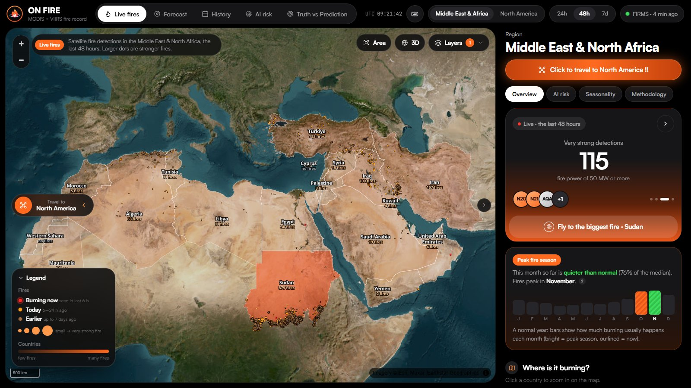

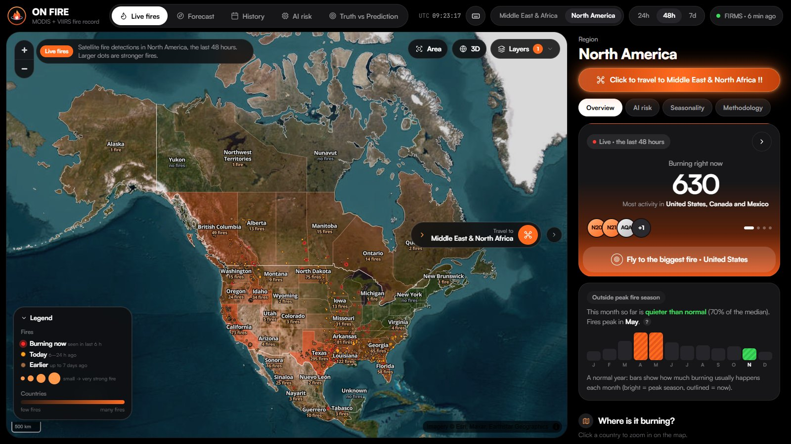

### 2. The harmonized burning-activity calendar
For every country and region: 25 years month by month (switch between amount and "compared to
normal"), the fire season, the worst month, the trend since 2001, the busiest years and months, and
this month against the **median** of the same month. Hovering a month shows its burning units, its %
of normal and the raw hotspots each sensor detected.

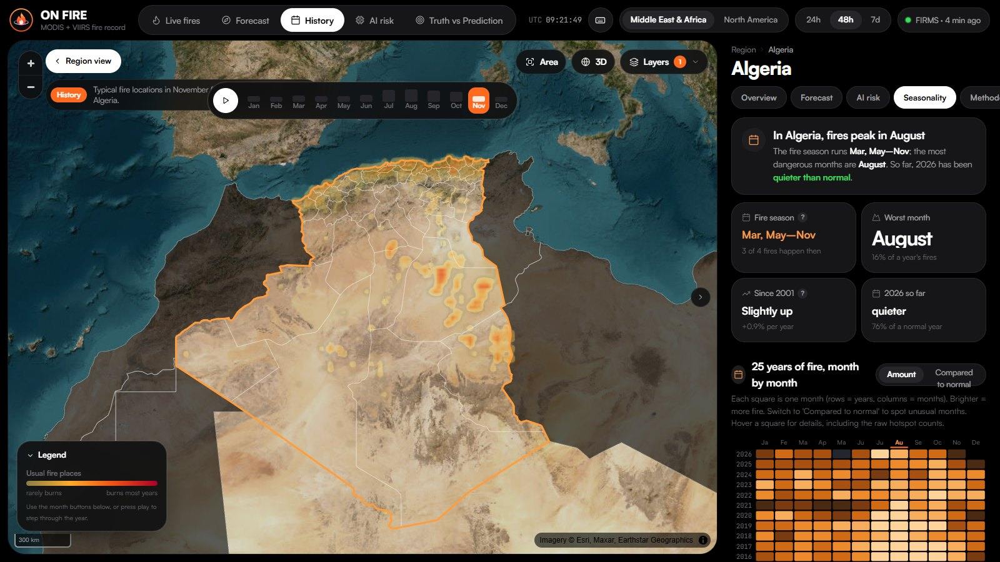

### 3. Any date range, with downloads
Pick any dates from November 2000 to yesterday: total burning, % of normal, busiest month and
hotspots detected, a monthly chart, a monthly summary (CSV) and **every hotspot in the range** (CSV,
MODIS + VIIRS). The full calendar downloads as CSV or PNG.

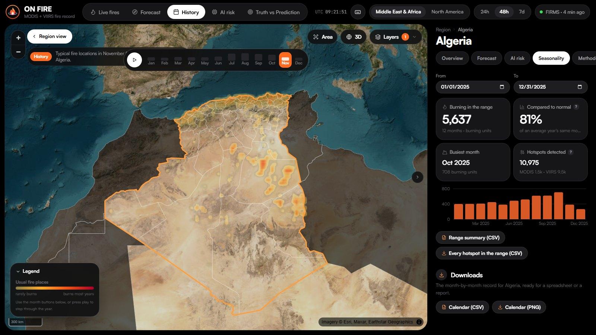

### 4. Any area of interest: draw a box or type coordinates
The area gets its own 25-year calendar (from a 25 km grid), extended to the latest satellite day, and
a card comparing this month with the **same dates in 2012–2025** (median, middle half, rank). A box
outside the covered countries is refused with a clear message instead of a false "no fire".

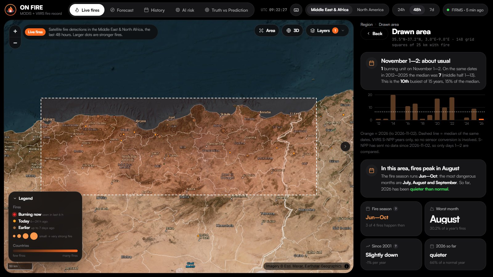

### 5. One fire: where it is going, who is in danger, how it compares with past fires
Spread rings for +3 / +6 / +12 / +24 hours from the wind forecast, the first town it could reach and
when, smoke direction, air quality, people and buildings nearby, estimated emissions, **its size
compared with every fire that burned within 50 km since 2012**, and exports for authorities (CAP 1.2
alert file, text brief, detections CSV). Alerts are decision support, labelled as estimates.

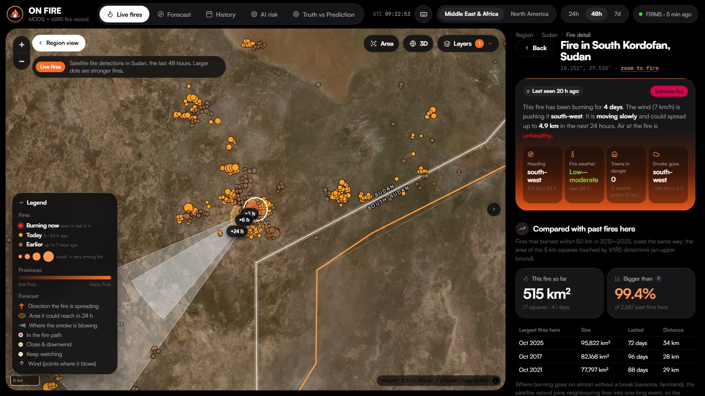

### 6. The proof, inside the app
The Methodology tab explains the harmonization for each place in plain words, with the before/after
comparison.

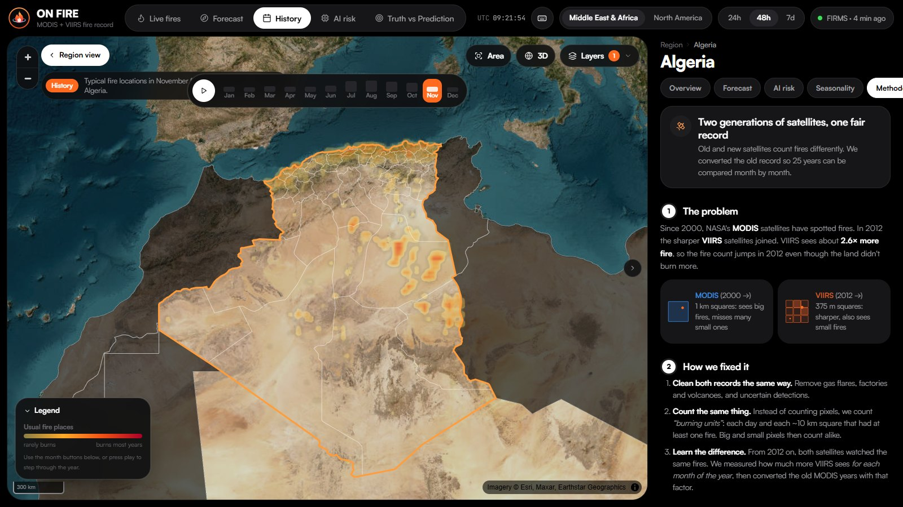

### 7. AI fire risk
A gradient-boosted decision-tree model gives each ~50 km cell its chance of fire this month or next,
marks red alerts, and explains every cell (which inputs pushed the risk up or down).

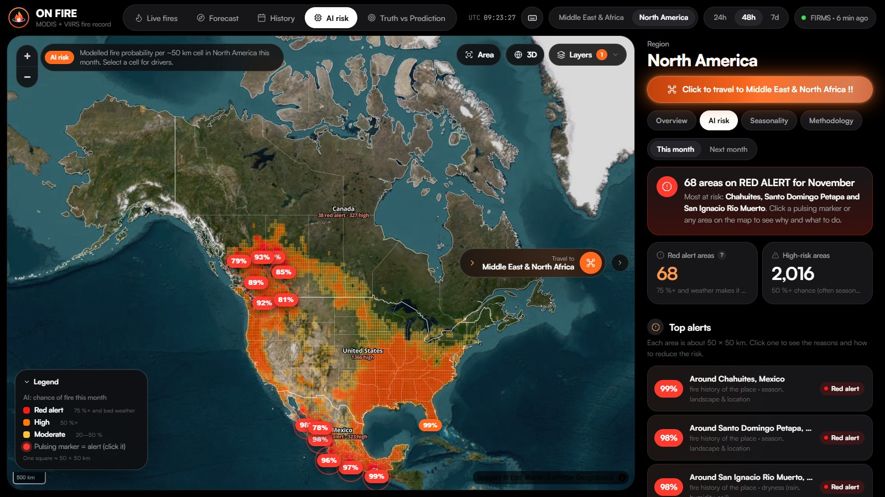

### 8. Truth vs Prediction
Six past fires replayed: the frozen model's risk map from before each fire against what actually
burned, including the fires it missed (Dixie 2021, Kabylie 2021, Manavgat 2021, plus three chosen by
a fixed rule).

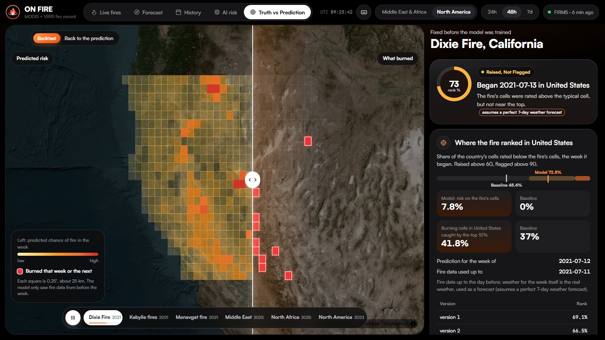

---

## How it works

### System overview

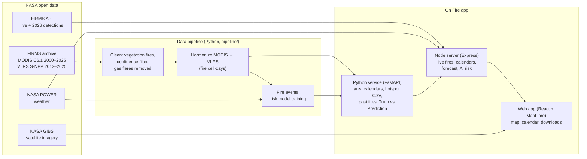

### Harmonization: making 25 years comparable

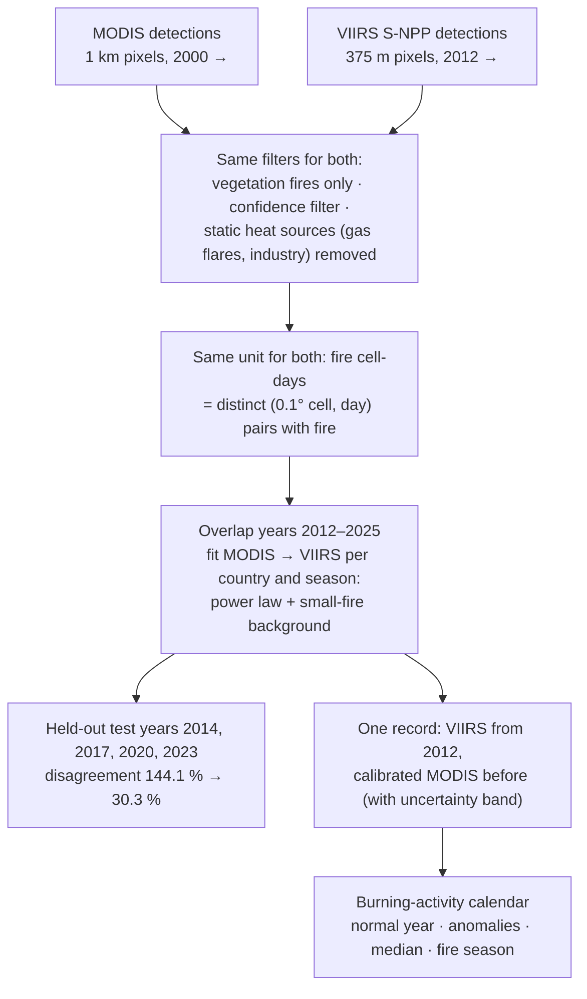

### The AI fire-risk model

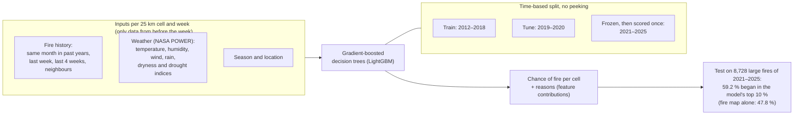

The AI risk page uses a second, monthly model of the same kind (written in JavaScript, one per region,
~50 km cells, NASA POWER weather): on 2023–2026 months it never trained on, AUC 0.912 for the Middle
East & North Africa (fire history alone 0.892) and 0.936 for North America (0.912).

---

## Results

**Harmonization** (scored on 2014, 2017, 2020 and 2023, which were never used for fitting or for choosing the method):

- Disagreement between MODIS-derived and VIIRS monthly country totals: **144.1 % → 30.3 %**.
- At the 2012 sensor switch, measured against MODIS alone: the harmonized series is off by a factor of 1.25; a naive switch of sensor is off by 6.5.
- Weakest for very small or flare-dominated countries (Bahrain 69 %, Cyprus 56 %, Qatar 54 %).

**Gas flares.** In Qatar 93.7 % of VIIRS detections are static industrial sources; Libya 83.9 %, Iraq 82.2 %, Iran 80.8 %, Algeria 80.5 %. Our behaviour-based detector agrees with NASA's static-source flag with 96.2 % precision and 97.0 % recall by detections (by location its recall is only 26.7 %: small, occasional sources are missed).

**Risk model** (trained to 2018, tuned on 2019–2020, frozen, scored on 2021–2025):

Three versions were trained; the one with the best 2019–2020 score is used. That is **version 3, which also uses the weather of the predicted week as a 7-day forecast. In these backtests the real weather stands in for the forecast, so every version-3 number assumes a perfect 7-day weather forecast** and is an upper bound. The best version without forecast weather (version 2) is shown next to it.

| 2021–2025, never used to choose | Version 3 (assumes a perfect 7-day weather forecast) | Version 2 (no forecast) | Baseline |
|---|---|---|---|
| Large fires (8,728) begun inside the country's top 10 % of risk | **59.2 %** | 58.4 % | 47.8 % |
| Precision-recall score | 0.569 | 0.550 | 0.441 |
| Burning cell-weeks inside the top 10 % of risk | 65.0 % | 63.5 % | 55.6 % |
| ROC-AUC | 0.924 | 0.919 | 0.859 |

- Three fires fixed before training (version 3, assumes a perfect 7-day weather forecast; version 2 in brackets): Kabylie 2021 flagged, 97.7th percentile (97.3); Dixie 2021 raised but not flagged, 72.5th (66.5); **Manavgat 2021 still not anticipated, 54.4th (46.3), even with perfect forecast weather**. Three more chosen by rule (largest per region): Canada 2023 flagged; Iraq 2025 raised; Sudan 2025 no better than baseline. All six are shown in the app.

---

## What works, limits, and future plans

**Working now:** everything shown above runs locally on Windows with `setup.bat`: live fires,
forecast, history map, AI risk, Truth vs Prediction, country / region / drawn-area calendars, date
ranges, median comparison, past-fire comparison, and all downloads.

**Limits (stated honestly):**
- Harmonized values before 2012 are estimates (typically within 0.58×–1.51× for a country-month).
- Satellites miss fires under cloud and between overpasses; "area touched" is an upper bound, not burned area.
- The risk model ranks places; it does not predict where a fire starts. Most of its skill comes from fire history. Weather is on a coarse grid.
- The spread envelope is a rule-of-thumb estimate that ignores terrain, vegetation and firefighting. Places under 500 people and people living outside named places are not counted. "Land around the fire" uses OpenStreetMap land use within 1.5 km, so unmapped fields can be missed. Air quality is only available from August 2022.
- The app is decision support. It drafts alert text; it never sends anything and never issues evacuation orders.
- VIIRS S-NPP has sent no data since 2 November 2026 (NASA FIRMS data-availability list). The app does not count those days as "no fire": unfinished months are left out of drawn-area calendars, and the country/region records fill November 2026 with calibrated MODIS.
- Coverage is the Middle East & North Africa and North America. A drawn box outside these countries is refused with a message.
- Past fires used for comparison are connected groups of VIIRS detections; where burning is almost continuous (savanna, farmland) one "fire" can be a whole season.
- It runs on the user's PC (no public hosting yet); a container for Google Cloud Run is prepared in `deploy/`.

**Future plans:** extend the same method to every region with MODIS and VIIRS coverage; add the
NOAA-20 and NOAA-21 VIIRS satellites to the long record; public hosting for agencies; e-mail or
SMS digests for civil-protection teams.

---

## Run it

**Quick start (Windows):** install [Node.js](https://nodejs.org) (LTS) and
[Python](https://www.python.org/downloads/) 3.11 or newer (tick "Add python.exe to PATH"), download
this repository (green **Code** button → **Download ZIP**, then unzip), and double-click
**`setup.bat`**. The first run installs the Python server packages into `.venv`, downloads the
25-year fire record (about 660 MB, from this repository's Releases) into `localdata`, builds the app
and opens http://localhost:8000. Later runs just start it. Needs an internet connection and about
3 GB of free disk. To stop it, close the "On Fire" window.

A NASA FIRMS map key is **included** in `.env` so the app runs as downloaded (live fires, the
forecast and 2026 in the calendars use it). It is a free key for open data, published on purpose
for judging. If it stops working (shared quota), get your own free key at
https://firms.modaps.eosdis.nasa.gov/api/map_key/ and replace the value in `.env`.

### Developer setup (rebuilding the data)

Requirements: Windows, Python 3.12, Node.js (tested with 26), about 4 GB of free disk for data.

```
python -m venv C:\Users\User\onfire-data\venv
C:\Users\User\onfire-data\venv\Scripts\pip install -r requirements.txt
run.bat
```

`run.bat` calls `web\start.cmd`, which copies `web/` to a working folder (`%ONFIRE_DATA%\web`), installs
its packages, builds the client with Vite and starts the Node server on port 8000; Node starts the
Python server (FastAPI) on 127.0.0.1:8001 and passes `/truth/` through to it.

The raw data (about 3 GB) is not in this repository. To rebuild everything:

| Step | Command (run from `pipeline/` with the venv's Python) | Time |
|---|---|---|
| Download the FIRMS archive | `bash ../scripts/download_firms.sh` | depends on connection |
| Convert to Parquet | `01_ingest.py` | ~5 min |
| Harmonize and validate | `02_harmonize.py` | ~3 min |
| Detect gas flares | `03_flares.py` | ~2 min |
| Download weather | `04_weather.py` | ~40 min |
| Group fire events | `05_events.py` | ~12 min |
| Country boundaries | `06_boundaries.py` (needs Natural Earth 50m countries in the work folder) | seconds |
| Weekly weather extremes for risk version 3 | `04b_weather_extremes.py` | ~30 min |
| Train and score the risk model | `07_risk.py` | ~20 min |
| Villages, towns and cities | `08_places.py` (needs GeoNames `cities500.txt` in `work/geonames/`) | seconds |

---

## NASA data and resources

| Resource | Source | How On Fire uses it |
|---|---|---|
| **FIRMS MODIS Collection 6.1** active fires (Terra, Aqua, 1 km) | https://firms.modaps.eosdis.nasa.gov (yearly country archives) | The historical half of the record, Nov 2000 – Dec 2025, for 25 countries; calibrated to the VIIRS scale. |
| **FIRMS VIIRS 375 m** active fires (Suomi NPP; NOAA-20 and NOAA-21 for live fires) | https://firms.modaps.eosdis.nasa.gov | The detailed half of the record (2012 →), live detections every 20 minutes, and 2026 for drawn areas. |
| **FIRMS API** (area, data availability, static-source flags) | https://firms.modaps.eosdis.nasa.gov/api/ | Live and 2026 data; the data-availability list detects the Nov 2026 S-NPP outage automatically; NASA's static-source flag checks our gas-flare detector. |
| **NASA POWER** (MERRA-2 based daily and monthly weather) | https://power.larc.nasa.gov | Temperature, humidity, wind, rain and soil moisture to train both fire-risk models. |
| **NASA GIBS** (VIIRS NOAA-20 corrected reflectance) | https://gibs.earthdata.nasa.gov | "Yesterday's pass" satellite base map, which shows smoke plumes. |

## Other resources and credits

**Data and services:** Open-Meteo forecast, archive and air-quality APIs (CC BY 4.0, air quality from
Copernicus CAMS) · OpenStreetMap via the Overpass API (ODbL) · GeoNames cities (CC BY 4.0) · Natural
Earth boundaries and places (public domain) · Esri World Imagery and Boundaries & Places base maps
(Esri, Maxar, Earthstar Geographics; attribution on the map) · OpenMapTiles fonts (Open Sans) for map labels.

**Software (open source):** React, Vite, MapLibre GL JS, Recharts, Express, compression, Turf, cobe,
concurrently, mapshaper · FastAPI, Uvicorn, DuckDB, pandas, NumPy, SciPy, scikit-learn, LightGBM,
Shapely, PyArrow, requests, Pillow.

**Fonts and icons:** Satoshi (Indian Type Foundry, via Fontshare) · JetBrains Mono (via Google Fonts,
SIL OFL) · line icons in the style of Lucide (ISC).

## Use of AI (Super Intelligence) — disclosure

- **Code and documentation:** written with the help of **Claude (Anthropic), through Claude Code**,
  as a coding assistant directed and reviewed by the team: the web app, the servers, the data
  pipeline and the documentation (including this README and the project-page texts). The working
  notes of that collaboration (plan and build log) are kept by the team and available on request.
- **Numbers:** every metric in the app and in this README is produced by the project's own scripts
  from NASA data; none is typed in by hand.
- **Machine learning in the product:** two gradient-boosted decision-tree models trained on NASA
  FIRMS and NASA POWER data: LightGBM in `pipeline/07_risk.py` (Truth vs Prediction) and a small
  JavaScript implementation in `web/server/lib/gbm.js`, trained by
  `web/server/scripts/train-risk-model.js` (AI risk page). Neither is a language model.
- **No AI service at run time:** the app calls no AI or language-model API; alert texts are fixed
  English templates filled with computed numbers.
- No NASA logos or branding are used.

## Project layout

```
web/        the app: React + Vite client (web/client), Node/Express server (web/server),
            its data (web/data: harmonized archive, map shapes, AI model)
app/        Truth vs Prediction and Documentation pages (plain JS), served by the Python server
server/     FastAPI service: area calendars, hotspot queries, past fires, Truth vs Prediction data
pipeline/   numbered scripts that build everything; results in pipeline/out/
deploy/     container build and (optional) Google Cloud Run deployment
docs/       screenshots used in this README
scripts/    data download
setup.bat   one-click setup and start for Windows
run.bat     starts the app on Windows (http://localhost:8000)
```

Not affiliated with NASA. NASA data is used under its open data policy.
